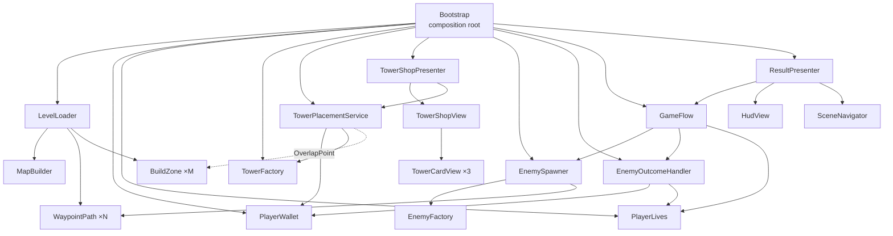

# Tower Defense Prototype — документация проекта

2D top-down Tower Defense на Unity **2023.2.20f1** (URP 2D). Учебный проект: главная цель — показать разделение ответственности, паттерны проектирования и архитектуру без «GameManager».

Документ описывает, **что** реализовано, **как** и **почему именно так**. Проверка соответствия заданию — в [REQUIREMENTS_CHECK.md](REQUIREMENTS_CHECK.md).

---

## Содержание

1. [Коротко об игре](#1-коротко-об-игре)
2. [Как запустить](#2-как-запустить)
3. [Структура проекта](#3-структура-проекта)
4. [Архитектура в целом](#4-архитектура-в-целом)
5. [Порядок запуска уровня](#5-порядок-запуска-уровня)
6. [Системы](#6-системы)
7. [Паттерны проектирования](#7-паттерны-проектирования)
8. [События (Observer)](#8-события-observer)
9. [Ключевые решения и их причины](#9-ключевые-решения-и-их-причины)
10. [Данные: ScriptableObject-ассеты](#10-данные-scriptableobject-ассеты)
11. [Графика, масштаб и звук](#11-графика-масштаб-и-звук)
12. [Editor-инструменты](#12-editor-инструменты)
13. [Как расширять](#13-как-расширять)
14. [Известные ограничения и технический долг](#14-известные-ограничения-и-технический-долг)

---

## 1. Коротко об игре

Враги идут волнами по дороге от левого края карты к правому. Игрок перетаскивает башни из магазина внизу экрана на каменные площадки возле дороги. За убитых врагов начисляется золото, за прорвавшихся снимаются жизни. Пройти все волны — победа, потерять все жизни — поражение.

| Сущность | Варианты |
|---|---|
| Враги | Normal (мечник со щитом), Fast (всадник), Tank (тяжёлый рыцарь) |
| Башни | Cannon — стреляющая; War Orchestra — аура ускорения атаки соседних башен; Great Bell — аура замедления врагов |
| Уровни | Village Road (обучающий), River Crossing (быстрая кавалерия), Castle Siege (две дороги, тяжёлые волны) |

---

## 2. Как запустить

- **Через меню:** открыть `Assets/Scenes/MainMenu.unity` → Play → выбрать уровень.
- **Сразу в игру:** открыть `Assets/Scenes/Game.unity` → Play. Загрузится уровень из поля **Default Level** у объекта `Bootstrap` (по умолчанию Village Road).
- **Build Settings:** `MainMenu` (0), `Game` (1).

---

## 3. Структура проекта

```
Assets/
├── Scripts/
│   ├── Core/          Bootstrap (composition root), PlayerWallet, PlayerLives, EnemyOutcomeHandler, GameFlow, ModifierStack
│   ├── Configs/       TowerConfig (+ Shooter/Aura/AttackSpeed/Slow), EnemyConfig, WaveConfig*, GameConfig*
│   ├── Interfaces/    ISlowable, IAttackSpeedModifiable, IPoolable, IAuraTower
│   ├── Enemies/       Enemy, EnemyFactory, EnemySpawner, WaypointPath
│   ├── Towers/        Tower, ShooterTower, AuraTower<T>, AttackSpeedAuraTower, SlowAuraTower, TowerFactory, TowerContext, RangeIndicator
│   ├── Projectiles/   ObjectPool<T>, ProjectilePool, Projectile
│   ├── Placement/     TowerPlacementService, BuildZone
│   ├── Levels/        LevelConfig, LevelLoader, MapBuilder, MapTheme, RoadEdgeTile, LevelCatalog, LevelSelection, SceneNavigator
│   ├── UI/Shop/       TowerShopModel, TowerShopView, TowerShopPresenter, TowerCardView
│   ├── UI/Hud/        HudView, ResultPresenter, SoundToggleView, SoundTogglePresenter
│   ├── UI/Menu/       LevelSelectView, LevelButtonView, LevelSelectPresenter, MainMenuBootstrap
│   ├── Visuals/       CannonAnimator, OrchestraAnimator, BellAnimator, EnemyWalkAnimator, SlowStatusView
│   ├── Audio/         CannonSound, BellSound, BackgroundMusic, SoundSettings
│   └── Editor/        10 Editor-скриптов с пунктами меню (см. раздел 12)
├── Configs/           ассеты: Enemies/, Towers/, Levels/ (3 уровня + LevelCatalog), MapTheme_Default
├── Prefabs/           башни, Enemy, Projectile, BuildZone, Tower card, UI/LevelButton
├── Scenes/            MainMenu, Game
├── Sprites/           Towers/, Enemies/, Map/Retina/ (тайлы Kenney 128 px), UI/Hud/, shop_cards/
├── Tiles/Map/         Tile-ассеты и Grass_RoadEdge (Rule Tile)
└── Audio/             SFX/ (выстрел, колокол), Music/ (The Old Tower Inn)
```
`*` — устаревшие классы, оставлены для совместимости (см. раздел 14).

Все скрипты в namespace `TowerDefense`, уровни — в `TowerDefense.Levels`, Editor-инструменты — в `TowerDefense.EditorTools`.

---

## 4. Архитектура в целом

### Слои

| Слой | Что это | Примеры |
|---|---|---|
| **Данные** | ScriptableObject-ассеты, только настройки | `EnemyConfig`, `TowerConfig`, `LevelConfig`, `MapTheme`, `LevelCatalog` |
| **Модель / доменная логика** | Обычные C#-классы без `MonoBehaviour` | `PlayerWallet`, `PlayerLives`, `EnemyOutcomeHandler`, `GameFlow`, `ModifierStack`, `TowerPlacementService`, фабрики, `LevelLoader` |
| **Игровые объекты** | `MonoBehaviour` на сцене и в префабах, своё поведение | `Enemy`, `Tower` и наследники, `Projectile`, `EnemySpawner`, `BuildZone`, `MapBuilder` |
| **Представления (View)** | UI без логики, только показ и события | `TowerShopView`, `TowerCardView`, `HudView`, `LevelSelectView`, `SoundToggleView` |
| **Презентеры** | Связывают View с моделью | `TowerShopPresenter`, `ResultPresenter`, `LevelSelectPresenter`, `SoundTogglePresenter` |
| **Визуал и звук** | Только подписываются на события, игровой логики нет | аниматоры башен и врагов, `CannonSound`, `BellSound` |
| **Composition root** | Создаёт и связывает всё перечисленное | `Bootstrap` (Game), `MainMenuBootstrap` (MainMenu) |
| **Editor-инструменты** | Воспроизводимая настройка ассетов и сцен | `Tools/Tower Defense/*` |

### Схема зависимостей (сцена Game)



Главные правила:
- **Нет синглтонов и глобального GameManager.** Объекты получают зависимости через конструктор или `Init(...)`.
- **`Bootstrap` не содержит игровой логики**: создаёт объекты, связывает их и подписывает друг на друга. Решения принимают сами системы (`GameFlow` решает, кто победил; `TowerPlacementService` решает, можно ли ставить башню).
- **Объекты не ищут друг друга на сцене** (`FindObjectOfType` в runtime-коде не используется). Всё, что нужно башне, приходит через `TowerContext`.
- **Визуал и звук отделены от логики**: башня не знает, что у неё есть анимация или звук.

---

## 5. Порядок запуска уровня

`Bootstrap.Awake` (`[DefaultExecutionOrder(-100)]`, выполняется раньше остальных скриптов):

1. **Выбор уровня.** Если пришли из меню — `LevelCatalog.Get(LevelSelection.SelectedIndex)`, иначе `Default Level`.
2. **`LevelLoader.Load(level)`:** `MapBuilder` рисует карту в Tilemap, создаются объекты `Path_0..N` с точками маршрута, на каждой площадке появляется `BuildZone`, камера подгоняется под размер сетки.
3. **Экономика:** `PlayerWallet(level.StartingGold)`, `PlayerLives(level.StartingLives)`.
4. **Башни:** `ProjectilePool.Initialize()` (создаётся 30 снарядов заранее), `TowerContext`, `TowerFactory`, `TowerPlacementService`.
5. **Магазин (MVP):** `TowerShopModel` → `TowerShopPresenter(model, view, placement, wallet, camera)`.
6. **Враги:** `EnemyOutcomeHandler`, `EnemySpawner.Init(EnemyFactory, paths)`, подписки на `EnemySpawned` и `WaveStarted`.
7. **Победа и поражение:** `GameFlow`; при поражении спавнер останавливается, `Time.timeScale = 0`.
8. **HUD и результат:** `HudView.Bind(wallet, lives)`, `ResultPresenter`.
9. **Звук:** `BackgroundMusic.Init(towersRoot)`, `SoundTogglePresenter(SoundSettings, view)`.

`Bootstrap.Start` запускает волны: `EnemySpawner.StartWaves(level.Waves, level.TimeBetweenWaves)`.

`Bootstrap.OnDestroy` отписывает все события и вызывает `Dispose()` у презентеров.

---

## 6. Системы

### 6.1. Уровни и карта (`Scripts/Levels`)

| Класс | Ответственность |
|---|---|
| `LevelConfig` (SO) | Всё про уровень: сетка 12×7, пути (точки поворота в клетках), площадки, местность (деревья, вода, камни, дома, стена), стартовое золото и жизни, волны (`WaveData` → `SpawnGroup`: враг, количество, интервал, задержка, индекс пути). `GridToWorld(cell)` — центр клетки в мире; сетка центрирована на (0, 0). `Validate()` + `OnValidate` предупреждают о площадке на дороге, диагональном отрезке пути, несуществующем индексе пути |
| `LevelLoader` | Раскладывает `LevelConfig` по сцене: карта, `WaypointPath` на каждую дорогу, `BuildZone` на каждую площадку, подгонка камеры. Возвращает `LoadedLevel { Config, Paths }` |
| `MapBuilder` | Рисует три Tilemap: **Ground** (трава, дорога, вода), **BuildSlots** (каменные площадки), **Decoration** (деревья, камни, дома, стена). Никогда не рисует декор поверх дороги и площадок. Вариант дерева или камня выбирается детерминированным хешем клетки, поэтому карта одинакова при каждой сборке. Чисто визуальный: геймплей тайлмапы не читает |
| `MapTheme` (SO) | Какими тайлами рисовать. Один и тот же уровень можно перекрасить, не трогая его данные |
| `RoadEdgeTile` | Подкласс `RuleTile` с собственными условиями соседей «дорога / не дорога». Края дороги в паке Kenney нарисованы на соседних клетках травы, поэтому трава сама выбирает спрайт края по тому, где рядом дорога (12 правил: 4 края, 4 внутренних угла, 4 внешних, плюс «трава между двумя дорогами = дорога») |
| `LevelCatalog` (SO) | Упорядоченный список уровней для меню и кнопки «Next level» |
| `LevelSelection` (static) | Одно поле — индекс выбранного уровня, переживает смену сцены. Сбрасывается в начале каждого Play Mode (`RuntimeInitializeOnLoadMethod`) |
| `SceneNavigator` | `LoadLevel(index)`, `OpenMenu()`. Каждая смена уровня перезагружает сцену Game |

### 6.2. Экономика, жизни и исход игры (`Scripts/Core`)

| Класс | Ответственность |
|---|---|
| `PlayerWallet` | Золото: `CanAfford`, `TrySpend`, `Add`, событие `GoldChanged`. Не знает про UI и башни |
| `PlayerLives` | Жизни: `Lose`, события `Changed` и `Depleted` |
| `EnemyOutcomeHandler` | Observer за врагами: на `Died` начисляет награду, на `ReachedFinish` снимает жизни. Считает живых врагов (`ActiveEnemies`) |
| `GameFlow` | Решает исход: победа = все волны отспавнены и врагов на поле не осталось; поражение = жизни кончились. События `Victory` и `Defeat`. Без UI и без спавна |
| `ModifierStack` | Хранит множители по источнику (`Dictionary<object, float>`) и отдаёт их произведение. Используется для замедления врагов и ускорения башен |

### 6.3. Враги (`Scripts/Enemies`)

| Класс | Ответственность |
|---|---|
| `EnemyConfig` (SO) | Здоровье, скорость, награда, урон по жизням, спрайт, режим поворота, кадры ходьбы, `Distance Per Cycle`, пыль |
| `Enemy` | Движение по `WaypointPath` (в цикле, чтобы быстрый враг не «проскакивал» поворот за один кадр) по своей **полосе** — линии, сдвинутой вбок от центра дороги на `LaneOffset` (случайно при появлении, в пределах `±LaneSpread`). Раз в 0.1 с враг смотрит вперёд: если там более медленный враг почти на той же полосе, он плавно уходит в свободную сторону (обгон без изменения скорости). Поворот к следующей точке, `TakeDamage`, смерть при `Health <= 0`. События `Died`, `ReachedFinish`, `HealthChanged`, `SpeedMultiplierChanged`. Реализует `ISlowable` через `ModifierStack`. `DistanceTravelled` — для выбора цели башней |
| `EnemyFactory` | Единственное место, где создаются враги: `Instantiate` + `Init(config, path)` |
| `EnemySpawner` | Волны: пауза → `WaveStarted` → все группы волны параллельно (каждая своей корутиной, со своей задержкой и по своему пути) → следующая волна. В конце — `AllWavesSpawned`. Про `LevelConfig` не знает: получает пути и данные волн |
| `WaypointPath` | Маршрут. Два режима: ручной (точки — Transform в сцене) и runtime (`SetPoints` из `LevelConfig`). `GetPoint(index, laneOffset)` — точка полосы, параллельной центру дороги; на поворотах угол строится по биссектрисе (miter), поэтому полоса держит расстояние до центра |

### 6.4. Башни (`Scripts/Towers`)

```
TowerConfig (abstract SO: имя, иконка, спрайт, цена, префаб)
├── ShooterTowerConfig        радиус атаки, урон, скорострельность, скорость снаряда
└── AuraTowerConfig (abstract) радиус эффекта, интервал сканирования
    ├── AttackSpeedTowerConfig  множитель скорости атаки
    └── SlowTowerConfig         множитель скорости врага

Tower (abstract MonoBehaviour: Init(config, context) → OnInit, Radius, RangeIndicator)
├── ShooterTower : IAttackSpeedModifiable
└── AuraTower<TTarget> : IAuraTower (abstract)
    ├── AttackSpeedAuraTower : AuraTower<IAttackSpeedModifiable>
    └── SlowAuraTower        : AuraTower<ISlowable>
```

- **`ShooterTower`** ищет врагов `Physics2D.OverlapCircle` по слою Enemy и выбирает того, кто **ближе всех к финишу** (`DistanceTravelled`). Пока цель жива и в радиусе, держит её. Стреляет с периодом `1 / (FireRate × множитель ускорения)`. Снаряд берёт из `ProjectilePool.Rent()`. Событие `Fired` нужно визуалу и звуку.
- **`AuraTower<T>`** раз в `ScanInterval` (0.2 с) сравнивает «кто в радиусе сейчас» с «на кого эффект уже наложен»: новичкам накладывает эффект, ушедшим снимает. При отключении башни снимает эффект со всех. `AffectedCount` и событие `AffectedCountChanged` нужны визуалу.
- **`AttackSpeedAuraTower`** ищет по слою Tower всё, что реализует `IAttackSpeedModifiable` (сейчас это `ShooterTower`), и вызывает `AddAttackSpeedModifier(this, 1.5)`.
- **`SlowAuraTower`** ищет по слою Enemy `ISlowable` и вызывает `AddSpeedModifier(this, 0.5)`.
- **`TowerContext`** — сервисы сцены для башен (пул снарядов, маски слоёв). Его передаёт фабрика, поэтому башни ничего не ищут сами.
- **`TowerFactory`** — единственное место, где создаются башни.

### 6.5. Снаряды (`Scripts/Projectiles`)

| Класс | Ответственность |
|---|---|
| `ObjectPool<T> where T : Component, IPoolable` | Обобщённый пул на `Stack<T>`: `Rent()` активирует и вызывает `OnRent`, `Return()` вызывает `OnReturn` и деактивирует. Защита от двойного возврата (`HashSet`). Предзаполнение |
| `ProjectilePool` | Пул снарядов на сцене. Единственное место, где вызывается `Instantiate` для снаряда: при предзаполнении (30 шт.) и при нехватке |
| `Projectile` : `IPoolable` | Летит к цели, на расстоянии попадания наносит урон и возвращается в пул. Если цель умерла или дошла до финиша, тоже возвращается в пул |

### 6.6. Установка башен (`Scripts/Placement`)

- **`TowerPlacementService`** владеет всеми правилами установки:
  1. хватает ли золота (`CanAfford`);
  2. есть ли под курсором `BuildZone` (`Physics2D.OverlapPoint` по слою BuildZone);
  3. не занята ли зона.

  `Validate` возвращает `PlacementResult` (`Success`, `NotEnoughGold`, `OutsideBuildZone`, `ZoneOccupied`) и используется для подсветки превью. `TryPlace` проверяет то же, списывает золото (`TrySpend` — окончательная проверка), создаёт башню через `TowerFactory`, занимает зону и вызывает событие `TowerPlaced`. При любом отказе башня не создаётся и золото не списывается.
- **`BuildZone`** — одна клетка: невидимый коллайдер 1×1 на слое BuildZone, свойство `Occupant`. Площадку игроку показывает каменный тайл из `MapBuilder`.

### 6.7. UI

**Магазин — MVP:**

| Класс | Роль |
|---|---|
| `TowerShopModel` | Только данные: список `TowerConfig` |
| `TowerShopView` | Создаёт карточки, показывает превью перетаскивания и сообщения, проверяет «курсор над магазином», пересылает события карточек наружу. Не создаёт башни и не трогает золото |
| `TowerCardView` | Одна карточка: иконка, кошель, цена; `IBeginDragHandler`/`IDragHandler`/`IEndDragHandler` → события `DragStarted`/`Dragged`/`DragEnded`. Подсветка при наведении (рамка и подъём, unscaled time). `SetAffordable` красит иконку и цену. Ничего не знает о золоте |
| `TowerShopPresenter` | Подписан на события View и `PlayerWallet.GoldChanged`. Переводит экранные координаты в мировые, спрашивает `TowerPlacementService.Validate` для цвета превью и вызывает `TryPlace` при отпускании. Сам не создаёт башен и не трогает физику |

**Остальной UI построен по тому же принципу «глупый View + Presenter»:**

| Экран | View | Presenter / модель |
|---|---|---|
| HUD | `HudView` (плашка «золото / жизни / волна», панель результата) | Наблюдает `PlayerWallet` и `PlayerLives`; кнопки результата обрабатывает `ResultPresenter` |
| Результат уровня | кнопки в `HudView` | `ResultPresenter`: Victory → «Next level» / «Menu», Defeat → «Restart» / «Menu» |
| Главное меню | `LevelSelectView`, `LevelButtonView` | `LevelSelectPresenter` (данные из `LevelCatalog`), `MainMenuBootstrap` |
| Звук вкл/выкл | `SoundToggleView` | `SoundTogglePresenter` + модель `SoundSettings` (`AudioListener.volume`, `PlayerPrefs`) |

### 6.8. Визуал и звук (`Scripts/Visuals`, `Scripts/Audio`)

Все эти компоненты **только подписываются на события** и не влияют на игру:

| Компонент | Слушает | Делает |
|---|---|---|
| `CannonAnimator` | `ShooterTower.Fired`, `CurrentTarget` | поворот ствола, вспышка, отдача, дым |
| `OrchestraAnimator` | `IAuraTower.AffectedCountChanged` | покачивание трубачей, ноты (больше нот, пока аура кого-то усиливает) |
| `BellAnimator` | `IAuraTower.AffectedCount` | качание колокола и звуковые волны до границы радиуса; событие `Tolled` |
| `EnemyWalkAnimator` | движение врага | кадр ходьбы **по пройденной дистанции**, пыль у всадника |
| `SlowStatusView` | `Enemy.SpeedMultiplierChanged` | кольцо замедления под врагом |
| `CannonSound` | `ShooterTower.Fired` | звук выстрела (лёгкий разброс высоты) |
| `BellSound` | `BellAnimator.Tolled` | звук удара, синхронно с качанием |
| `BackgroundMusic` | флаг «есть ли хотя бы один оркестр под `Towers`», проверяется каждый кадр | один источник музыки на уровень, играет, пока стоит хотя бы один оркестр |

---

## 7. Паттерны проектирования

| Паттерн | Где | Зачем |
|---|---|---|
| **Composition Root / Dependency Injection** (ручной) | `Bootstrap`, `MainMenuBootstrap` | Вся сборка объектов в одном месте; системы получают зависимости через конструктор или `Init`, нет скрытых глобальных связей и GameManager |
| **Factory** | `TowerFactory`, `EnemyFactory` | Единственная точка создания башен и врагов; UI и сервис установки не вызывают `Instantiate` |
| **Object Pool** | `ObjectPool<T>`, `ProjectilePool`, `IPoolable` | Снаряды переиспользуются вместо `Instantiate`/`Destroy` на каждый выстрел |
| **Observer** (C# events) | `Enemy.Died`, `PlayerWallet.GoldChanged`, `TowerCardView.Drag*`, `GameFlow.Victory` и др. (раздел 8) | Системы общаются, не зная друг о друге; визуал и звук подключаются без изменения логики |
| **Model–View–Presenter** | магазин, HUD/результат, меню, кнопка звука | View «глупые»: показывают и сообщают о действиях; решения — в презентере и модели |
| **Type Object** (через ScriptableObject) | `EnemyConfig`, `TowerConfig`, `LevelConfig` | Тип врага, башни или уровня — это данные; новый тип = новый ассет, без нового класса |
| **Template Method** | `Tower.Init` → `OnInit`; `AuraTower<T>.OnInit` → `OnAuraInit`, `ApplyEffect`, `RemoveEffect` | Общий алгоритм в базовом классе, детали — в наследниках |
| **Generics как Strategy цели** | `AuraTower<TTarget>` | Одна реализация ауры для двух эффектов; тип цели задаёт, на кого действовать |
| **Interface Segregation** | `ISlowable`, `IAttackSpeedModifiable`, `IPoolable`, `IAuraTower` | Аура знает только «умеет замедляться / ускоряться», пул — только «умеет арендоваться»; визуал видит ауру только для чтения |
| **Service** | `TowerPlacementService` | Все правила установки в одном классе, отдельно от UI |
| **Data-driven levels** | `LevelConfig` + `LevelLoader` + `MapBuilder` | Уровень = ассет; карта, дороги, зоны, экономика и волны из одного источника |
| **Modifier Stack** | `ModifierStack` | Несколько аур одного типа корректно перемножаются и снимаются независимо |

---

## 8. События (Observer)

| Событие | Кто вызывает | Кто слушает |
|---|---|---|
| `Enemy.Died` | `Enemy.Die` | `EnemyOutcomeHandler` (золото, счётчик) |
| `Enemy.ReachedFinish` | `Enemy.Finish` | `EnemyOutcomeHandler` (жизни, счётчик) |
| `Enemy.SpeedMultiplierChanged` | `ModifierStack.Changed` | `SlowStatusView` |
| `PlayerWallet.GoldChanged` | `TrySpend`, `Add` | `HudView`, `TowerShopPresenter` (доступность карточек) |
| `PlayerLives.Changed` / `Depleted` | `Lose` | `HudView` / `GameFlow` |
| `TowerCardView.DragStarted` / `Dragged` / `DragEnded` | обработчики drag | `TowerShopView` → (свои события) → `TowerShopPresenter` |
| `TowerPlacementService.TowerPlaced` | `TryPlace` | точка расширения (сейчас не используется) |
| `ShooterTower.Fired` | `Fire` | `CannonAnimator`, `CannonSound` |
| `IAuraTower.AffectedCountChanged` | `AuraTower.Scan` | `OrchestraAnimator` |
| `BellAnimator.Tolled` | `PlayToll` | `BellSound` |
| `EnemySpawner.EnemySpawned` | `Spawn` | `EnemyOutcomeHandler.Register` |
| `EnemySpawner.WaveStarted` | `RunWaves` | `HudView.ShowWave` |
| `EnemySpawner.AllWavesSpawned` | `RunWaves` | `GameFlow` |
| `EnemyOutcomeHandler.EnemyRemoved` | смерть или финиш врага | `GameFlow.CheckVictory` |
| `GameFlow.Victory` / `Defeat` | `CheckVictory` / `OnLivesDepleted` | `ResultPresenter`, `Bootstrap` (остановка спавна и пауза) |
| `HudView.NextLevelClicked` / `RestartClicked` / `MenuClicked` | кнопки результата | `ResultPresenter` |
| `SoundSettings.Changed` | `Toggle` | `SoundToggleView` (через презентер) |

Все подписки снимаются в `OnDestroy` / `OnDisable` / `Dispose`.

---

## 9. Ключевые решения и их причины

1. **Composition root вместо GameManager.** `Bootstrap` только связывает объекты. Логика разнесена по маленьким классам с одной ответственностью, их можно тестировать и заменять по отдельности.
2. **`ModifierStack` с ключом-источником.** Если замедлять врага напрямую (`speed *= 0.5`), две пересекающиеся ауры либо перезапишут друг друга, либо при уходе одной снимут чужой эффект. Словарь «источник → множитель» и произведение решают обе проблемы.
3. **Ауры пересканируют радиус по таймеру, а не по trigger-событиям.** `OnTriggerEnter/Exit` теряются при спавне внутри радиуса, при уничтожении объекта и при выключенном коллайдере. Сравнение «сейчас в радиусе» с «уже под эффектом» раз в 0.2 с надёжно и дёшево.
4. **Выбор цели «ближе всех к финишу».** Стандарт жанра: башня бьёт самого опасного врага, а не ближайшего к себе.
5. **Размер спрайтов через Pixels Per Unit, а не Scale.** У врагов один общий префаб, спрайт приходит из конфига, а Scale исказил бы радиусы и позиции деталей башен. Правило «клетка = 1 юнит» и таблица размеров собраны в `SpriteSizeNormalizer`: башня ≈ 0.91 клетки, рыцарь = башня, мечник = 2/3 башни, всадник = 4/3 башни по длине.
6. **Анимация ходьбы по пройденной дистанции, а не по времени.** Замедленный враг шагает медленнее, остановившийся стоит: ноги не «скользят» по земле.
7. **`LevelConfig` — единый источник данных уровня.** Карта, дороги, зоны, экономика и волны в одном ассете, и они не могут разойтись (как было, когда путь был в сцене, а карта — в конфиге).
8. **Смена уровня через перезагрузку сцены.** Пул, подписки, кошелёк и башни создаются заново, ручной сброс состояния не нужен и не может что-то забыть.
9. **Static `LevelSelection`, а не ScriptableObject.** Статическое поле переживает `LoadScene` и сбрасывается при каждом новом Play. SO в редакторе сохраняет значение между запусками и требует ссылок в обеих сценах.
10. **Свой `RoadEdgeTile` вместо обычного Rule Tile.** Обычный Rule Tile различает только «я / не я», и рядом с водой или краем карты появились бы ложные края дороги.
11. **Невидимые `BuildZone` + тайл площадки.** Геймплей (коллайдер) отделён от вида (тайл), площадка выглядит частью карты.
12. **Музыка по флагу «есть оркестр», а не по событию установки.** Один источник на уровень, сколько бы оркестров ни стояло; музыка остановится сама, если оркестров не останется (на будущее, для продажи башен).
13. **Полосы и обгон вместо одной линии.** Враги на одной линии сливались, конница пробегала сквозь рыцарей. Случайная полоса разносит волну по ширине дороги, а простой обгон (сдвиг полосы, скорость не меняется) не трогает баланс. Полноценная физика толкания или steering не нужна: врагов немного, а дорога шириной в клетку.
14. **Editor-скрипты вместо ручной настройки.** Настройку можно повторить одним пунктом меню и объяснить на защите; ассеты обновляются на месте, GUID и ссылки сохраняются.

---

## 10. Данные: ScriptableObject-ассеты

| Ассет | Ключевые значения |
|---|---|
| `Configs/Enemies/Enemy_Normal` | HP 100, скорость 2, награда 12, урон по жизням 1 |
| `Configs/Enemies/Enemy_Fast` | HP 40, скорость 3, награда 8, урон 1, пыль |
| `Configs/Enemies/Enemy_Tank` | HP 350, скорость 1, награда 30, урон 3 |
| `Configs/Towers/Tower_Shooter` | цена 50, радиус 4, урон 25, 1.5 выстрела/с, скорость снаряда 10 |
| `Configs/Towers/Tower_AttackSpeed` | цена 70, радиус 3, множитель 1.5 |
| `Configs/Towers/Tower_Slow` | цена 60, радиус 2.5, множитель скорости 0.5 |
| `Configs/Levels/Level_01_VillageRoad` | 150 золота, 10 жизней, 5 волн, 13 площадок |
| `Configs/Levels/Level_02_RiverCrossing` | 175 золота, 10 жизней, 5 волн, 13 площадок, река |
| `Configs/Levels/Level_03_CastleSiege` | 250 золота, 15 жизней, 6 волн, 18 площадок, две дороги |
| `Configs/Levels/LevelCatalog` | порядок уровней |
| `Configs/MapTheme_Default` | тайлы карты |

Уровни задаются в `LevelGenerator.cs` и генерируются пунктом меню; правки в Inspector перезапишутся при повторной генерации.

---

## 11. Графика, масштаб и звук

- **Стиль:** Kenney «Tower Defense (top-down)» для карты (Retina-тайлы 128 px, PPU 128) + собственные спрайты башен и врагов (256 px).
- **Масштаб:** 1 клетка = 1 юнит. Камера ортографическая, подгоняется под сетку 12×7 (`orthographicSize = max(h/2, w/(2·aspect))`).
- **Порядок отрисовки** (Sorting Layer Default): Ground −30, BuildSlots −20, Decoration −10, пыль −2, кольцо замедления −1, враги и башни 0–3, снаряды и частицы 10–11.
- **Слои физики:** Enemy (6), Tower (7), BuildZone (8). У врага `CircleCollider2D` r = 0.35 и kinematic `Rigidbody2D`, у башни `BoxCollider2D` 0.9×0.9, у зоны 1×1 (все триггеры).
- **Звук:** выстрел и удар колокола — `PlayOneShot` на `AudioSource` башни; музыка — один `AudioSource` на объекте Music; выключение через `AudioListener.volume`.

---

## 12. Editor-инструменты

| Пункт меню | Что делает |
|---|---|
| `Tools/Tower Defense/Normalize Sprite Sizes` (+ `Report Only`) | Выставляет PPU по таблице размеров (видимый размер по альфе) |
| `Tools/Tower Defense/Setup Enemy Animations` | Режет листы ходьбы на 8 кадров, заполняет `EnemyConfig`, собирает префаб `Enemy` (аниматор, кольцо, пыль) |
| `Tools/Tower Defense/Import HD Tower Sprites (256)` | Заменяет текстуры башен на 256 px на месте, пересчитывает нарезку |
| `Tools/Tower Defense/Create Map Theme` | Тайлы, `Grass_RoadEdge` с правилами, `MapTheme_Default` |
| `Tools/Tower Defense/Generate Sample Levels` | Три `LevelConfig` |
| `Tools/Tower Defense/Setup Map In Scene` | Grid с тремя Tilemap, `MapBuilder`, корни `BuildZones`/`Paths`, префаб `BuildZone`, ссылки `Bootstrap` |
| `Tools/Tower Defense/Setup Level Switching` | `LevelCatalog`, сцена `MainMenu`, кнопки результата, Build Settings |
| `Tools/Tower Defense/Setup Audio` | Настройки клипов, звуки на префабах башен, объект Music, кнопка звука |
| `Tools/Tower Defense/Setup HUD` | Плашка HUD «золото / жизни / волна» |
| `Tower Defense/Setup/Apply Shop Style B` | Карточки магазина в стиле HUD и панель магазина |

Все инструменты можно запускать повторно: существующие объекты и ассеты переиспользуются.

---

## 13. Как расширять

- **Новый враг:** создать ассет `Create → Tower Defense → Enemy Config`, назначить спрайт и кадры, добавить в группы волн в `LevelGenerator` (или в Inspector уровня).
- **Новая башня-аура с другим эффектом:** интерфейс эффекта (как `ISlowable`), реализовать его у цели, наследник `AuraTower<IНовыйЭффект>` с `ApplyEffect`/`RemoveEffect`, конфиг-наследник `AuraTowerConfig`, префаб, добавить конфиг в `Bootstrap._shopTowers`.
- **Новый уровень:** метод в `LevelGenerator` (пути, площадки, местность, волны), путь к ассету в `LevelSwitchingSetup.LevelPaths`, затем `Generate Sample Levels` и `Setup Level Switching`.
- **Новый визуал или звук для существующего события:** отдельный компонент, подписанный на событие башни или врага; логику трогать не нужно.

---

## 14. Известные ограничения и технический долг

| Что | Почему так / что сделать |
|---|---|
| Враги не в пуле (`Destroy` при смерти) | Не требовалось заданием; врагов на порядки меньше, чем снарядов. Можно перевести на `ObjectPool<Enemy>` |
| Устаревшие `WaveConfig`, `GameConfig`, ассеты `Wave_01–03`, `GameConfig.asset`, объект `Path` в сцене Game | Остались после перехода на `LevelConfig`; ни одна сцена их не использует. Удалить после подтверждения |
| Неиспользуемая графика: статичные `enemy_*.png`, `trumpeters_band`, `bell_top`, 299 тайлов 64 px в `Sprites/Map/Default size` | Не попадают в сборку (на них нет ссылок), но засоряют проект |
| `DisplayName` башен — `Tower_Shooter`, `Tower_AttackSpeed`, `Tower_Slow` | Значения по умолчанию; на экране не показываются (карточки без названия). Стоит переименовать в Cannon / War Orchestra / Great Bell |
| Эффект ауры появляется и снимается с задержкой до 0.2 с | Цена надёжного сканирования по таймеру; интервал настраивается в конфиге |
| Коллайдер врага один на все типы (r = 0.35) | Префаб общий; для точного попадания по длинному всаднику нужен размер из конфига |
| Тайлы дома и площадки похожи | В паке Kenney нет домов; на River Crossing два «дома» можно принять за площадки |
| Магазин на уровне 1 перекрывает две нижние площадки на 14 px | Принято осознанно; при необходимости — Pos Y = 0 у `ShopPanel` |
| Изменения в `LevelConfig` через Inspector перезаписываются генератором | Уровни задаются кодом `LevelGenerator` (единый источник). Альтернатива — генерировать только отсутствующие ассеты |
| `CLAUDE.md`, раздел «Текущий статус», устарел | Отражает состояние после первого аудита; актуальное описание — этот документ |
